<div align="center">

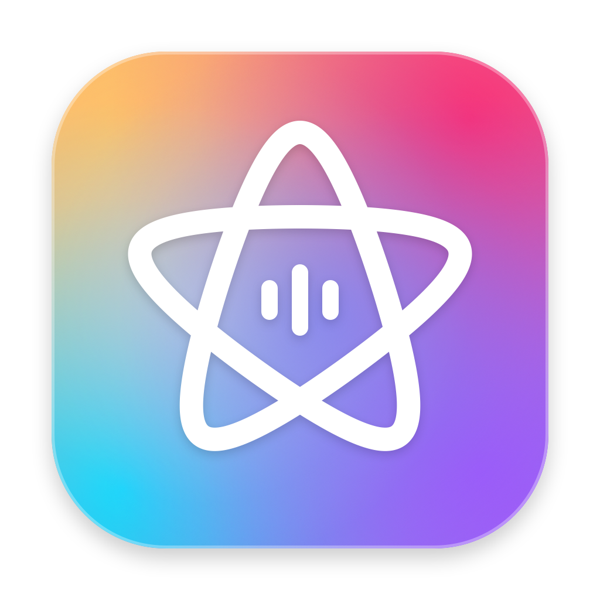

# SenseBar

**Your Mac's notch, made useful.**<br>
**Biến tai thỏ MacBook thành một phần thật sự hữu ích.**

Dynamic Island · Per-app volume mixer · Device alerts

[Tiếng Việt](#tiếng-việt) · [English](#english)

[](#yêu-cầu)
[](#yêu-cầu)
[](Package.swift)
[](LICENSE)

[**Tải bản mới nhất / Download latest**](https://github.com/Ngochiendev/SenseBar/releases)

</div>

<table>
  <tr>
    <td align="center" width="50%">
      <br>
      <sub><b>MacBook Notch</b> · <a href="assets/dynamic-island-notch.mp4">MP4 (30 fps)</a></sub>
    </td>
    <td align="center" width="50%">
      <br>
      <sub><b>External Display Capsule</b> · <a href="assets/dynamic-island-capsule.mp4">MP4 (30 fps)</a></sub>
    </td>
  </tr>
</table>

---

# Tiếng Việt

SenseBar là tiện ích Menu Bar cho macOS, kết hợp Dynamic Island với bộ trộn âm lượng từng ứng dụng. Trên MacBook, Island ôm sát tai thỏ thật. Trên Mac mini, iMac, Mac Intel và màn hình rời, nó chuyển thành notch ảo hoặc capsule.

## Hai phần chính

| Dynamic Island | Audio Studio |
|---|---|
| Now Playing với ảnh bìa, tiến trình và ghim nguồn phát | Chuyển nhanh thiết bị đầu ra |
| Phát, dừng, chuyển bài, tua và mở app đang phát | Âm lượng tổng và tắt tiếng |
| Mở rộng khi rê chuột hoặc bấm vào Island | Âm lượng riêng từng app 0–200% |
| Notch, capsule và nhiều màn hình | Nhận diện app đang phát/tạm nghỉ |
| Thú cưng (Companion) tương tác trực tiếp | Không cần driver âm thanh ảo |
| Thông báo sạc, kết nối và pin yếu | CoreAudio process tap chạy cục bộ |

### Dynamic Island phù hợp với từng màn hình

SenseBar tự nhận biết tai thỏ vật lý, hỗ trợ màn hình tích hợp, màn hình chính, màn hình theo con trỏ hoặc tất cả màn hình. Bạn có thể chỉnh chiều rộng, chiều cao, khoảng cách mép trên, chọn notch/capsule cho màn hình không có tai thỏ và ghim nguồn phát nhạc ưu tiên ngay trên Island mở rộng.

Nội dung tự ẩn khi ứng dụng khác chạy toàn màn hình. Liquid Glass gốc được dùng trên macOS hỗ trợ; macOS cũ hơn dùng bề mặt tĩnh nhẹ để giảm chi phí GPU. Thú cưng (Companion) có kiểu Tối giản hoặc Robot, tự ngủ sau 5 phút không thao tác và phản ứng theo trạng thái phát nhạc hoặc sạc pin.

<p align="center">
  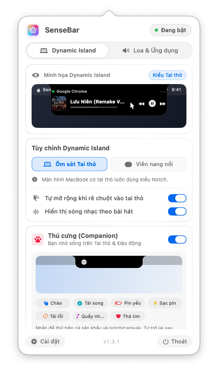
  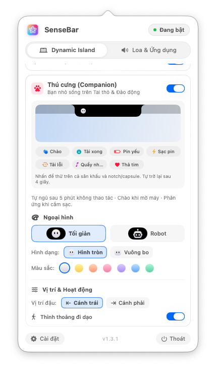
</p>

### Âm lượng từng ứng dụng

Audio Studio điều chỉnh gain riêng cho từng tiến trình âm thanh bằng CoreAudio. App đang tạm nghỉ vẫn giữ nguyên nhóm khi bạn thay đổi mức âm lượng. Mức 100% là âm lượng gốc; dải 100–200% dùng để boost (+dB) và có giới hạn bảo vệ đầu ra.

<p align="center">
  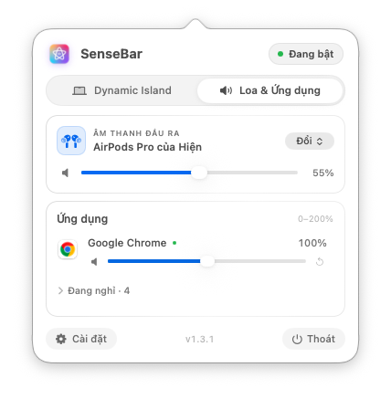
  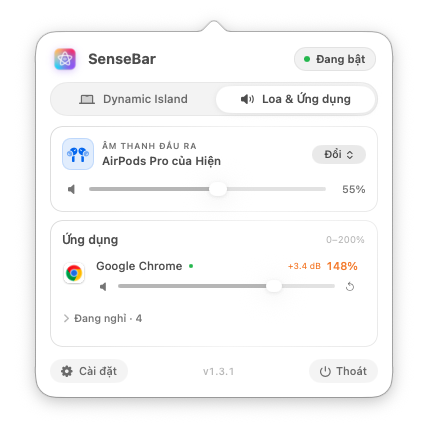
  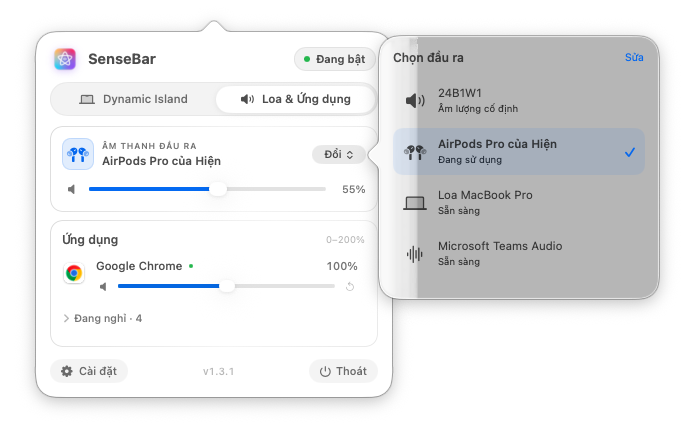
</p>

### AirPods và phụ kiện

Khi bạn chủ động bật thông báo thiết bị, SenseBar có thể hiển thị kết nối AirPods, tai nghe, bàn phím, chuột, trạng thái sạc MacBook và cảnh báo pin ở 20%/10%.

Dữ liệu pin phụ thuộc vào những gì thiết bị và macOS cung cấp. Một số phụ kiện chỉ báo trạng thái kết nối.

<p align="center">
  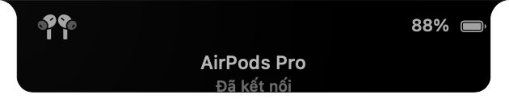
  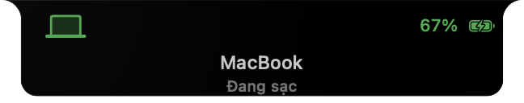
</p>

<details>
<summary>Xem thêm ảnh chụp Cài đặt &amp; trạng thái Island</summary>

<p align="center">
  
  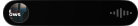
</p>

<p align="center">
  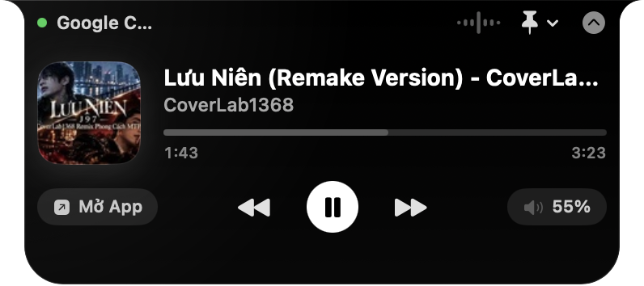
  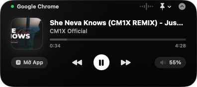
</p>

<p align="center">
  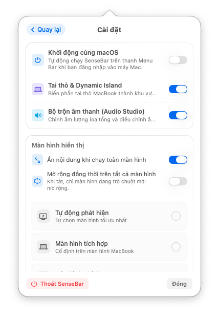
  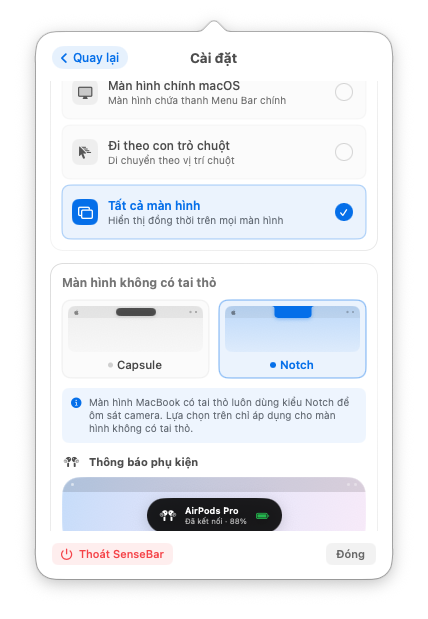
  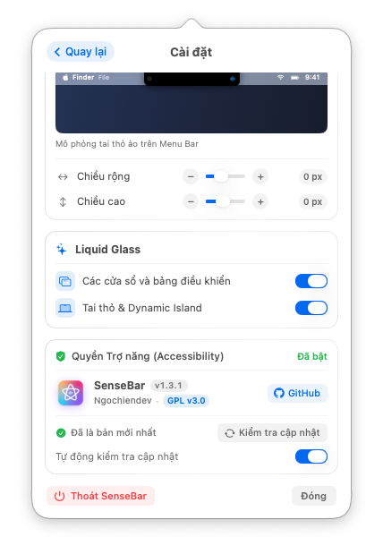
</p>

</details>

## Cài đặt

1. Tải DMG tại [GitHub Releases](https://github.com/Ngochiendev/SenseBar/releases).
2. Kéo **SenseBar** vào thư mục **Applications**.
3. Mở ứng dụng và làm theo onboarding.
4. Bật quyền **Trợ năng** tại **Cài đặt Hệ thống → Quyền riêng tư & Bảo mật → Trợ năng** (và **Bluetooth** nếu bạn giữ bật thông báo phụ kiện).
5. Quay lại SenseBar; nút tiếp tục sẽ mở khi macOS xác nhận quyền.

<p align="center">
  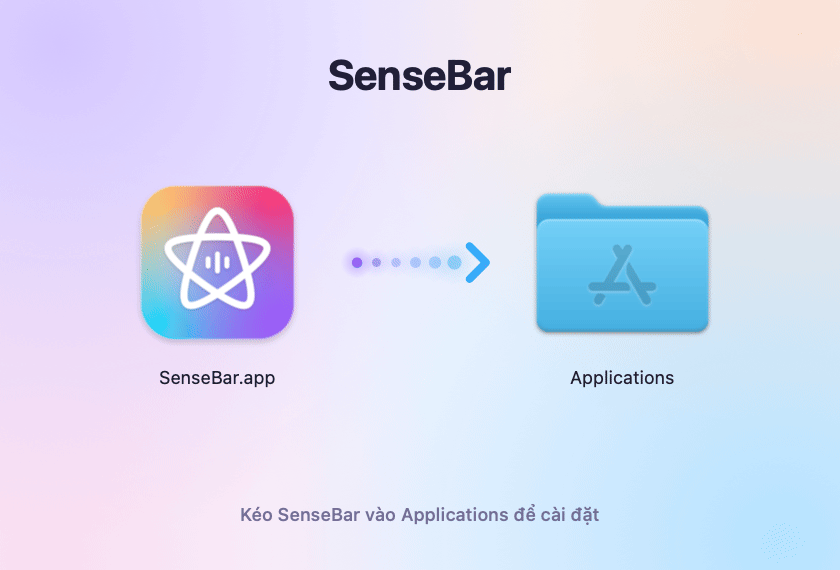<br>
  <sub><a href="assets/install-sensebar.mp4">Xem bản MP4</a></sub>
</p>

## Yêu cầu

- macOS 14 Sonoma trở lên.
- Apple Silicon hoặc Intel 64-bit.
- Quyền Trợ năng để hoàn tất thiết lập và sử dụng ứng dụng.
- Artifact phát hành là Universal Binary gồm `arm64` và `x86_64`.

## Quyền riêng tư

| Quyền | Thời điểm | SenseBar dùng để |
|---|---|---|
| **Trợ năng** | Onboarding, bắt buộc | Nhận tương tác chuột toàn cục cho Island |
| **Bluetooth** | Khi bật thông báo thiết bị | Nhận kết nối và pin phụ kiện |
| **Audio Capture** | Khi mixer cần điều chỉnh app | Áp dụng gain riêng trên máy |
| **Automation** | Chỉ khi tích hợp trình phát yêu cầu | Gửi lệnh điều khiển phát |

Now Playing, âm thanh và thông tin thiết bị được xử lý trên máy. SenseBar không có tài khoản, quảng cáo hoặc telemetry riêng. Kiểm tra cập nhật sử dụng Sparkle qua HTTPS tới appcast đã ký (`updates.sensebar.site`) và có thể kiểm tra thủ công hoặc tắt tự động kiểm tra trong Cài đặt.

## Build nhanh

Cần Xcode Command Line Tools với Swift 6.

```zsh
git clone https://github.com/Ngochiendev/SenseBar.git
cd SenseBar

./build-app.sh --debug
killall SenseBar 2>/dev/null || true
open build/SenseBar.app
```

`./build-app.sh` tạo Universal release; `./build-app.sh --dmg` tạo DMG. Chạy kiểm tra tích hợp bằng:

```zsh
./build/SenseBar.app/Contents/MacOS/SenseBar --selftest
```

Chi tiết kiến trúc, coding convention và quy trình pull request nằm trong [CONTRIBUTING.md](CONTRIBUTING.md).

## Khắc phục quyền khi test

```zsh
killall SenseBar 2>/dev/null || true
tccutil reset All com.sensebar.SenseBar
defaults delete com.sensebar.SenseBar 2>/dev/null || true
```

Lệnh `defaults delete` xóa toàn bộ cài đặt SenseBar cục bộ.

---

# English

SenseBar is a macOS menu bar utility that combines a Dynamic Island with a per-app volume mixer. It wraps around the physical notch on MacBook. On Mac mini, iMac, Intel Mac, and external displays, it becomes a virtual notch or floating capsule.

## Two focused experiences

| Dynamic Island | Audio Studio |
|---|---|
| Now Playing with artwork, progress, and source pinning | Fast output-device switching |
| Play, pause, skip, seek, and jump to player | Master volume and mute |
| Hover or click to expand | Independent app volume from 0–200% |
| Notch, capsule, and multi-display modes | Active and paused app grouping |
| Interactive Companion | No virtual audio driver |
| Charging, connection, and battery alerts | Local CoreAudio process taps |

### Built for every display

SenseBar detects physical notches and can target the built-in display, primary display, display under the pointer, or every display. Virtual notch and capsule dimensions can be tuned for non-notched screens, and you can switch or pin your preferred media player right from the expanded Island.

Content hides while another app is full screen. Supported macOS versions use native Liquid Glass; older versions use lightweight static surfaces to reduce GPU work. Companion offers Minimal and Robot looks, sleeps after 5 minutes idle, and reacts to media playback and power events.

<p align="center">
  
  
</p>

### Per-app volume

Audio Studio applies independent gain to audio processes through CoreAudio. Paused apps remain in their group when their saved volume changes. 100% preserves the original level; the 100–200% range provides bounded boost (+dB).

<p align="center">
  
  
  
</p>

### AirPods and accessories

After you explicitly enable device notices, SenseBar can show AirPods, headphones, keyboards, mice, MacBook power events, and low-battery warnings at 20% and 10%.

Battery detail depends on information exposed by the accessory and macOS. Some devices expose connection state without battery values.

<p align="center">
  
  
</p>

<details>
<summary>More screenshots: Settings &amp; Island states</summary>

<p align="center">
  
  
</p>

<p align="center">
  
  
</p>

<p align="center">
  
  
  
</p>

</details>

## Install

1. Download the DMG from [GitHub Releases](https://github.com/Ngochiendev/SenseBar/releases).
2. Drag **SenseBar** into **Applications**.
3. Open the app and follow onboarding.
4. Enable **Accessibility** in **System Settings → Privacy & Security → Accessibility** (and **Bluetooth** if you keep accessory alerts enabled).
5. Return to SenseBar; Continue unlocks after macOS confirms access.

<p align="center">
  <br>
  <sub><a href="assets/install-sensebar.mp4">Watch MP4</a></sub>
</p>

## Requirements

- macOS 14 Sonoma or later.
- Apple Silicon or 64-bit Intel.
- Accessibility access to finish setup and use the app.
- Release artifacts are Universal Binaries with `arm64` and `x86_64`.

## Privacy

| Permission | When | Purpose |
|---|---|---|
| **Accessibility** | Required during onboarding | Global pointer interaction for Island |
| **Bluetooth** | Device notices are enabled | Accessory connections and battery values |
| **Audio Capture** | The mixer adjusts an app | Apply per-app gain locally |
| **Automation** | A player integration requires it | Send playback commands |

Now Playing, audio, and device information are processed locally. SenseBar has no accounts, ads, or first-party telemetry. Update checks use Sparkle over HTTPS against a signed appcast (`updates.sensebar.site`) and can be run manually or disabled in Settings.

## Quick build

Requires Xcode Command Line Tools with Swift 6.

```zsh
git clone https://github.com/Ngochiendev/SenseBar.git
cd SenseBar

./build-app.sh --debug
killall SenseBar 2>/dev/null || true
open build/SenseBar.app
```

`./build-app.sh` creates a Universal release and `./build-app.sh --dmg` creates a DMG. Run the integrated validation with:

```zsh
./build/SenseBar.app/Contents/MacOS/SenseBar --selftest
```

See [CONTRIBUTING.md](CONTRIBUTING.md) for architecture, coding conventions, and the pull request workflow.

## Reset a test installation

```zsh
killall SenseBar 2>/dev/null || true
tccutil reset All com.sensebar.SenseBar
defaults delete com.sensebar.SenseBar 2>/dev/null || true
```

The `defaults delete` command removes all local SenseBar preferences.

---

<div align="center">

[Releases](https://github.com/Ngochiendev/SenseBar/releases) ·
[Contributing](CONTRIBUTING.md) ·
[Security](SECURITY.md) ·
[GPL-3.0](LICENSE)

Made for macOS by [Ngochiendev](https://github.com/Ngochiendev)

</div>
