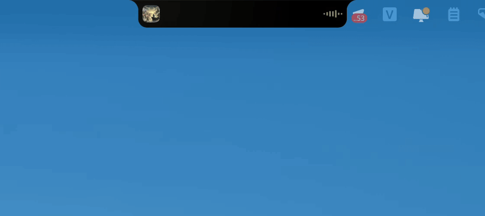
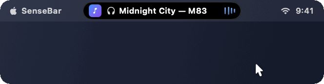

<p align="center">
  
</p>

<h1 align="center">SenseBar</h1>

<p align="center">
  <strong>Dynamic Island cho MacBook và bộ trộn âm lượng từng ứng dụng, gọn nhẹ trên thanh Menu Bar.</strong>
</p>

<p align="center">
  
  
  
  
</p>

<p align="center">
  
</p>

---

## Giới thiệu

SenseBar gồm hai tính năng, bật hoặc tắt riêng từng cái:

- **Tai thỏ & Dynamic Island**: biến tai thỏ MacBook thành khu vực điều khiển nhạc đang phát.
- **Bộ trộn âm thanh (Audio Studio)**: chỉnh âm lượng loa tổng và âm lượng riêng cho từng ứng dụng, từ 0% đến 200%.

Máy không có tai thỏ (Mac Intel, Mac mini, iMac, màn hình rời) vẫn dùng đầy đủ. SenseBar tự chuyển sang dạng **viên nang nổi** ở giữa thanh Menu Bar.

<p align="center">
  
  
</p>

---

## Tính năng

### Tai thỏ & Dynamic Island

- **Đang phát**: hiện ảnh bìa, tên bài hát và nút phát/tạm dừng, chuyển bài, tua. Hoạt động với các trình phát có báo Now Playing cho macOS (Apple Music, Spotify, trình duyệt...).
- **Sóng nhạc**: thanh sóng chuyển động theo trạng thái phát, lấy màu từ ảnh bìa.
- **Mở rộng khi rê chuột**: rê chuột vào tai thỏ hoặc viên nang để mở bảng điều khiển, rời chuột thì tự thu gọn.
- **Hai kiểu hiển thị** cho màn hình không có tai thỏ: ôm sát như tai thỏ ảo, hoặc viên nang nổi. Có thanh trượt chỉnh chiều rộng, chiều cao và khoảng cách mép trên, kèm hình xem trước trực tiếp.
- **Chọn màn hình hiển thị**: tự động, màn hình tích hợp, màn hình chính, theo con trỏ chuột hoặc tất cả màn hình.
- **Ẩn khi toàn màn hình**: tự ẩn khi xem video hoặc chơi game toàn màn hình.
- **Liquid Glass**: dùng kính lỏng gốc trên macOS 26. Trên macOS 14–15 và máy Intel, SenseBar dùng lớp kính mờ nhiều tầng giả lập để nhẹ và vẫn đẹp.

### Bộ trộn âm thanh (Audio Studio)

- **Âm lượng loa tổng** và tắt tiếng nhanh, có hiển thị tên thiết bị đầu ra hiện tại.
- **Âm lượng từng ứng dụng** từ 0% đến 200%, kèm tắt tiếng riêng từng ứng dụng.
- Không cần cài driver âm thanh ảo hay kext của bên thứ ba.

### Khác

- Giao diện tiếng Việt và tiếng Anh.
- Tùy chọn khởi động cùng macOS.
- Một bảng điều khiển duy nhất trên Menu Bar chứa toàn bộ cài đặt.

---

## Yêu cầu hệ thống

- **macOS 14.0 (Sonoma)** trở lên.
- Bản phát hành là **Universal Binary**, chạy native trên Apple Silicon (M1 trở lên) và Mac Intel 64-bit, không qua Rosetta.

---

## Cài đặt

1. Tải file `SenseBar-vX.X.X-macOS-Universal.dmg` tại [GitHub Releases](https://github.com/Ngochiendev/SenseBar/releases).
2. Mở file `.dmg`, kéo **SenseBar** vào thư mục **Applications**.
3. Mở SenseBar từ Launchpad hoặc Spotlight.
4. Cấp quyền **Trợ năng (Accessibility)** khi được hỏi. Quyền này cần để Dynamic Island nhận chuột và nhận biết ứng dụng toàn màn hình. Sau khi bật công tắc trong Cài đặt Hệ thống, SenseBar tự nhận ngay, không cần mở lại ứng dụng.

> Mọi dữ liệu xử lý hoàn toàn trên máy của bạn, SenseBar không gửi thông tin ra ngoài.

---

## Build từ mã nguồn

Yêu cầu: macOS 14.0+, Xcode Command Line Tools (Swift 6).

```bash
git clone https://github.com/Ngochiendev/SenseBar.git
cd SenseBar

# Bản debug nhanh (kiến trúc của máy), mở thử ngay
./build-app.sh --debug && open build/SenseBar.app

# Bản release Universal (arm64 + x86_64)
./build-app.sh

# Đóng gói file .dmg
./build-app.sh --dmg
```

Kiểm tra nhanh các thành phần cốt lõi:

```bash
build/SenseBar.app/Contents/MacOS/SenseBar --selftest
```
---

## Giấy phép

SenseBar được phát hành theo giấy phép **GNU General Public License v3.0**. Xem chi tiết tại [LICENSE](LICENSE).

Tác giả: **Ngochiendev**
